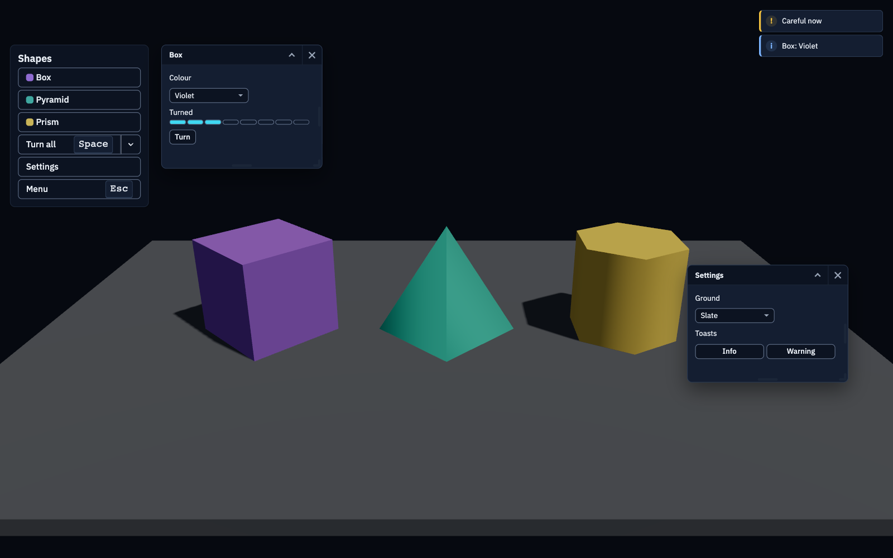

::: scene exampleUiKit
Three shapes and a HUD. Click a shape's button for its window, pick a colour and turn it, open
the split button's menu to turn one shape, open the settings for the ground and a toast, and
press Space to turn them all. Escape opens the pause menu: the arrows choose, Enter presses,
Escape resumes, and Reload the scene shows the app's loading overlay.
:::

The HUD is built from the [UI kit](hub:features/ui-kit), on `aekasha/ui`: kit buttons with
tooltips and key hints, a split button with a menu, two kinds of window, drop-downs, a segmented
progress bar, a toaster and a dialog. The scene loader every scene goes through is the kit's
loading overlay. Everything the scene adds goes when it exits.

