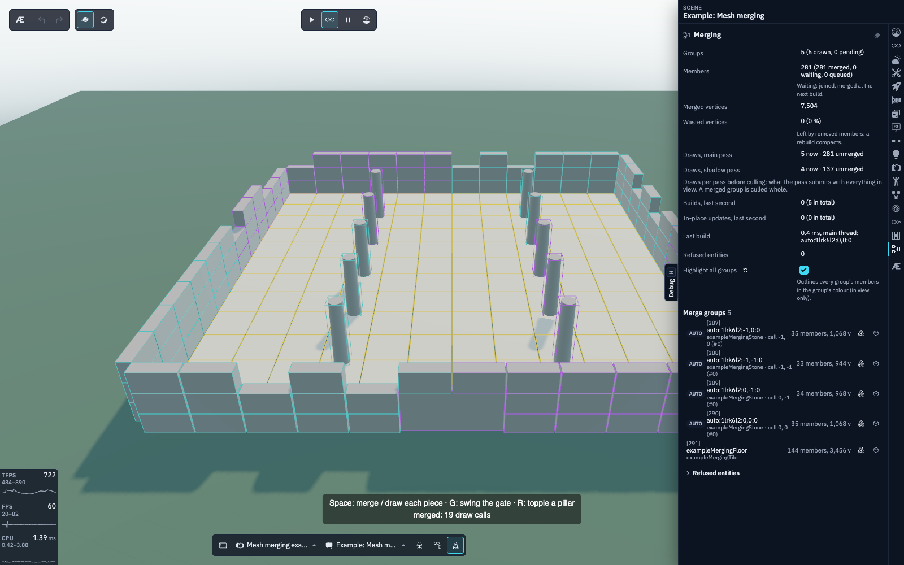

## Installing it

List [`merging()`](api:merging), from `aekasha/merging`, in `InitEngine`'s `features` (see
[How the app starts](hub:examples/quick-start#how-the-app-starts)), after `physics()`: a scene's
groups are then built once its bodies exist. The merge code loads with the first group a scene
builds.

- Without `merging()`, a mesh's `merge` warns once and the mesh is drawn on its own, and the
  functions on `aekasha/merging` throw, naming the feature.
- A scene whose JSON has a mesh's `merge` or a `mergeGroups` list fails the boot without it,
  naming the feature (see [the feature manifest](hub:features/scenes-and-assets#the-feature-manifest)).

## A merge group

A merge group is an entity that owns one merged mesh. Its members are mesh entities that share a
material: each keeps its transform, its physics body, its geometry and material and its data,
and only its own mesh is hidden while the group draws it.

```ts
import { createMeshEntity } from 'aekasha';
import { addToMergeGroup, createMergeGroup } from 'aekasha/merging';

createMergeGroup({ id: 'ruins', castShadow: true, receiveShadow: true });
const walls = [0, 4, 8].map((x) =>
  createMeshEntity({ geo: 'wallGeo', mat: 'stoneMat', position: { x } })
);
addToMergeGroup('ruins', walls);
```

- **One draw per group and pass.** The group is drawn once in the main pass and once in each
  shadow pass that draws its members.
- **Built in the next frame**: what joins a group during a frame is merged once, in the next
  frame's render sync (an app's first build also waits a frame for the merge code to load). A
  group of more than 65 536 vertices merges in the assets worker, its new members drawn on their
  own until it's in, so no frame goes without them.
- **Culled whole.** The group is one bounding sphere: in view, all of it is drawn. It's the entry
  in the spatial index too (its members leave the `DEFAULT` domain while merged), and a member's
  own culling and LOD settings do nothing while it's merged.
- **Scene-scoped.** A group goes with the scene it was made in, and its members with theirs.
  `persistent: true` keeps a group across scene switches, and only such a group takes
  `persistent` members.
- [`dissolveMergeGroup`](api:dissolveMergeGroup) deletes the group: its members are drawn on
  their own again at once. [`getMergeGroupOf`](api:getMergeGroupOf) names an entity's group.

## Joining a group

A mesh joins a group by its `merge` prop, in code or JSON:

- **A group's id** (`merge: 'ruins'`): the group is made on first use, with the settings of the
  scene's `mergeGroups` entry for it, else its first member's shadow flags.
  [`createMergeGroup`](api:createMergeGroup) makes one with settings of its own.
- **`'AUTO'`**: the engine picks the group (see [AUTO](#auto)).
- **`{ group?, cellSize?, maxVertices? }`**: `AUTO` (the default) with this mesh's own cell size
  and vertex cap.

```json
{
  "props": {
    "geo": "ruinKitWall",
    "mat": "ruinStone",
    "position": { "x": 4, "y": 0, "z": 0 },
    "merge": "AUTO"
  }
}
```

A mesh's `merge` waits for the next build (or the scene load's end) before it joins: by then an
imported model has created its bodies and your code has placed the mesh, so the checks and
`AUTO`'s cell see where it ends up. [`addToMergeGroup`](api:addToMergeGroup) adds entities that
exist already; `addToMergeGroup('AUTO', ids)` queues them as the prop does.

### AUTO

`AUTO` groups meshes that can be drawn together and are near each other:

- **The key:** the material (the same registered material, not a look-alike), the geometry's
  attributes, both shadow flags, the render layers, and whether the mesh is `persistent`. Meshes
  that differ in any of them never share a group.
- **The cell:** square cells on x and z, 32 m a side by default, from the mesh's position when it
  joins. A group never spans two cells, so it stays small enough to be culled usefully.
- **The cap:** 262 144 vertices by default; a full group opens the next one in its cell.
- **The ids** are derived (`auto:<key hash>:<cx>,<cz>:<n>`), and a scene gets the same ones on
  every visit.

A scene sets its own defaults, and gives a named group its settings:

```json
{
  "mergeGroups": [
    { "id": "AUTO", "cellSize": 50 },
    { "id": "courtyardFloor", "castShadow": false, "receiveShadow": true }
  ]
}
```

Pick the cell size from the view: large enough that a cell holds many pieces, small enough that
most of a group is in view when any of it is. `largeWorld` (a 200 m terrain) uses 50 m cells, the
example's 24 m courtyard 16 m ones.

### Imported models

- A **`merge` custom property** on a Blender node (the glTF `extras`: `AUTO` or a group's id)
  merges that node's mesh, like the physics properties (see
  [From imported models](hub:features/physics#from-imported-models)).
- **`spawnImportedAsset`'s `merge`** (`'AUTO'`, an id or the options) applies to every visible
  piece of the model. A node's own property wins over it, and the spawn's `meshProps` over both.
- A piece of a physics group whose body isn't `FIXED` is left out of the spawn's `merge`: it moves
  with its body. A node's own `merge` there is refused when it joins.

Joining the pieces at build time instead ([an imported asset's `merge`](hub:features/asset-optimization#merging-a-model-s-pieces))
costs nothing at load, but the pieces are gone as nodes. A merge group keeps them entities.

## Members are static

A merged member is drawn where it was when it was merged. Move one, and tell its group:

```ts
import { getECSWorld, getEntityIdByAppId } from 'aekasha';
import { updateMergeMember } from 'aekasha/merging';

const gate = getEntityIdByAppId('ruinGate')!;
getECSWorld().setTransform(gate, { pos: { x: 4, y: 0, z: 12 } });
updateMergeMember(gate);
```

- [`updateMergeMember`](api:updateMergeMember) rewrites only the member's part of the merged
  mesh, positions, normals and tangents, in place: no rebuild, no allocation. The group's bounds
  only grow until its next build.
- [`removeFromMergeGroup`](api:removeFromMergeGroup) takes a member out: it's drawn on its own at
  once, free to move, and its triangles in the merged mesh are collapsed in place. Deleting a
  member does the same. Once a quarter of a group's vertices are unused, the group builds again,
  compact, in the next frame.
- **Disabling a member** hides its part of the merged mesh, and enabling it shows it again,
  without a rebuild.
- [`rebuildMergeGroup`](api:rebuildMergeGroup) merges a group again from where its members are
  now.

A member's `TRANSFORM` changing isn't enough: the engine doesn't watch it (a fixed body's sync
would look like a move). In debug mode, a member moved without `updateMergeMember` warns once,
naming it and its group.

### Moving a member over many frames

`updateMergeMember` writes the member's part once. For a member that moves for a while (a drag in
an editor tool), an edit session draws it on its own meanwhile and writes it into the merged mesh
once, at the end:

```ts
import { getECSWorld, getEntityIdByAppId } from 'aekasha';
import { beginMergeMemberEdit, endMergeMemberEdit } from 'aekasha/merging';

const gate = getEntityIdByAppId('ruinGate')!;
beginMergeMemberEdit(gate);
getECSWorld().setTransform(gate, { pos: { x: 4, y: 0, z: 12 } }); // as often as the drag moves
endMergeMemberEdit(gate);
```

- [`beginMergeMemberEdit`](api:beginMergeMemberEdit) hides the member's part of the merged mesh
  (in place, no rebuild) and draws its own mesh, which follows its `TRANSFORM`: moving it costs
  the group nothing per frame.
- [`endMergeMemberEdit`](api:endMergeMemberEdit) writes its part where it is now, draws it merged
  again and moves its physics body there (a fixed body doesn't follow its mesh).
- [`cancelMergeMemberEdit`](api:cancelMergeMemberEdit) puts it back where it was at the begin,
  then ends. [`isMergeMemberInEdit`](api:isMergeMemberInEdit) says whether a session is open.
- A scene exit cancels the open sessions. A member removed or deleted meanwhile stays where it
  is, on its own; a group rebuilt meanwhile keeps the member on its own until the end.

### Which member a ray hit

A raycast hits the group's mesh, whose `userData.entityId` is the group's entity.
[`getMergeMemberAtFace`](api:getMergeMemberAtFace) resolves the hit's face to the member drawn
there (a search of the group's part table, no allocation):

```ts
import * as THREE from 'three/webgpu';
import { getRootScene } from 'aekasha';
import { getMergeMemberAtFace } from 'aekasha/merging';

const ray = new THREE.Raycaster(new THREE.Vector3(0, 10, 0), new THREE.Vector3(0, -1, 0));
const [hit] = ray.intersectObject(getRootScene()!, true);
const hitEntityId = hit?.object.userData.entityId as number | undefined;
const memberId =
  hitEntityId !== undefined && hit.faceIndex != null
    ? getMergeMemberAtFace(hitEntityId, hit.faceIndex)
    : undefined;
```

It's `undefined` for a face of a member removed since the build, and for anything that isn't a
built group.

## Scene loads

A scene's groups are built during its load, after its code has placed its meshes and physics has
created their bodies, and before the loader goes away. Meanwhile the members are held from
drawing, so the scene's first frame is already merged, and a geometry only merged members use is
never uploaded to the GPU on its own. A merge that fails is logged, and its members are drawn on
their own until the next frame builds them.

## What can't be merged

These are refused with a warning naming the entity and the reason, and drawn on their own:

- skinned meshes, morph targets, instanced meshes and instanced pool instances;
- transparent materials (they're sorted per object), and a material array;
- a material other than the group's (a group has one material);
- dynamic and kinematic bodies, and tier-frozen dynamic ones (a `FIXED` body is fine: it stays
  per member, as do its colliders);
- an entity a manager owns (`managedBy`), or one with a `LOD`;
- an entity in another group, a `persistent` one in a group that isn't, and a geometry whose
  attributes don't fit the group's.

## When to merge

| Tool                                                                  | For                                      | Draws                   | Moves                        | Culled           |
| --------------------------------------------------------------------- | ---------------------------------------- | ----------------------- | ---------------------------- | ---------------- |
| [Instancing](hub:features/lod#many-instances)                         | many copies of one geometry and material | one per pool (or level) | every frame                  | per instance     |
| **A merge group**                                                     | different geometries, one material       | one per group           | rarely (`updateMergeMember`) | the group, whole |
| [A merged geometry](hub:features/scenes-and-assets#merged-geometries) | a fixed assembly (a wall section)        | one per mesh            | as one mesh                  | the mesh         |
| Each mesh on its own                                                  | anything                                 | one per mesh            | freely                       | per mesh         |

- **Many copies of one thing:** instancing.
- **Many different static things sharing a material:** a merge group, bounded by a cell.
- **Different materials:** one group per material (`AUTO` does this by itself).
- **Things that move, fade or need their own culling or LOD:** not a merge.

Merging pays most where a scene has many small pieces in view at once, and in every pass that
draws them: a light whose shadow covers them gains as much again. It gains little for a few large
meshes (each is one draw anyway), and costs drawing for a group mostly out of view: a group is
drawn whole whenever any of it is in the frustum.

### Measured

`largeWorld`'s ruins (398 wall, pillar, floor and rubble pieces in 8 sites) and 11 static props,
409 members in 28 `AUTO` groups of 50 m cells, against the same scene with every group dissolved
(Chrome on macOS, 1000 × 700; the main camera draws the scene twice, for its ambient occlusion):

| Sun, backend                  | Main draws | Shadow draws | CPU frame (median) |
| ----------------------------- | ---------- | ------------ | ------------------ |
| scene's, WebGPU, merged       | 76         | 18           | 2.25 ms            |
| scene's, WebGPU, on its own   | 762        | 19           | 3.23 ms            |
| scene's, WebGL2, merged       | 76         | 18           | 2.48 ms            |
| scene's, WebGL2, on its own   | 762        | 19           | 3.59 ms            |
| day-night, WebGPU, merged     | 76         | 15           | 2.39 ms            |
| day-night, WebGPU, on its own | 762        | 53           | 3.77 ms            |
| day-night, WebGL2, merged     | 76         | 15           | 2.27 ms            |
| day-night, WebGL2, on its own | 762        | 53           | 3.40 ms            |

- The main camera's draws per pass go from 381 to 38, and the CPU frame time drops by 30-37 % on
  both backends. The triangles stay the same: 38 members outside the view are drawn with their
  groups, but almost every ruin is in view.
- The scene's own sun has a fixed shadow box around the origin that reaches no ruin, so its
  shadow pass gains nothing. The day-night sky's sun follows the camera, and its shadow pass drops
  from 53 draws to 15.

## Streaming

In a [streaming](hub:features/streaming) scene, keep each group inside a cell:

- An `AUTO` cell size should divide the streaming cell size, and a build whose members are in two
  streaming cells warns (each once per scene).
- A group doesn't load, unload, prime or fade with a cell: a member whose cell unloads leaves the
  group's mesh collapsed in place, and a cell loaded during play draws its members on their own
  until the next frame merges them (the group's mesh may compile its shaders on its first draw).

## Debugging

In debug mode (`?isDebug=true`), the drawer's **Merging** tab (`h`, the last tab) shows what
merging does in the scene. Here on the [mesh merging example](hub:examples/merging), with
**Highlight all groups** on (the overlay's lines add their own draws to the example's count):



- **The summary:** the groups and their members, the merged vertices and the wasted ones (left by
  removed members until the next build), each pass's draws now against every member drawn on its
  own (before culling: what the pass submits with everything in view), the builds and in-place
  updates in the last second, the last build's time, and how many entities were refused.
- **Highlight all groups** outlines the members of every group in view, each group in a colour
  of its own (it draws with the [lines](hub:features/lines) feature).
- **The groups:** a row per group (an `AUTO` one with its material and cell), which opens the
  group's window; its two buttons outline the group's members and show it unmerged.
- **Refused entities:** each entity whose `merge` was refused, with the reason.

A **group's window** shows its state, settings, members, vertices and wasted vertices, with
Rebuild (which compacts too) and Dissolve; a member row opens the member's window. A **member's
window** shows its group (a button opens the group's window), its state, geometry, material and
part of the merged mesh, and its position, rotation and scale as fields: editing them moves the
member in an [edit session](#moving-a-member-over-many-frames), drawn on its own while you drag
and written in place when you let go.
"Remove from group" takes it out. The profiler's Objects tab opens a group mesh's window too.

- **Undo** (`Ctrl/⌘ + Z`) takes back a dissolve, a removal and each move, during the scene visit
  they were made in: members are named by entity id, which another visit can give to another
  entity.
- **Show unmerged** (a group's row or window) hides the group's mesh and draws its members on
  their own, until you turn it off or the scene exits: an A/B of the image and the draw count. The
  image stays the same (but where two members' faces lie in one plane: draw order picks which
  shows), and each pass draws the members one by one instead of the group's one mesh, less those
  now culled on their own.

## Not yet

- One material per group: meshes with different materials make a group each.
- A group's level of detail: members with a `LOD` are refused.

See the plans, [merge groups](repo:docs/plans/_DONE_p372_mesh-merge-groups.md) and
[merge debugging and member editing](repo:docs/plans/p373_merge-debug-and-member-editing.md),
and their epic, [static mesh merging](repo:docs/plans/p370_static-mesh-merging-and-texture-atlas-systems.md).

## Key APIs

- [`merging()`](api:merging).
- [`createMergeGroup`](api:createMergeGroup), [`addToMergeGroup`](api:addToMergeGroup),
  [`removeFromMergeGroup`](api:removeFromMergeGroup) and
  [`dissolveMergeGroup`](api:dissolveMergeGroup).
- [`updateMergeMember`](api:updateMergeMember) and [`rebuildMergeGroup`](api:rebuildMergeGroup).
- Edit sessions: [`beginMergeMemberEdit`](api:beginMergeMemberEdit),
  [`endMergeMemberEdit`](api:endMergeMemberEdit),
  [`cancelMergeMemberEdit`](api:cancelMergeMemberEdit) and
  [`isMergeMemberInEdit`](api:isMergeMemberInEdit).
- [`getMergeGroupOf`](api:getMergeGroupOf) and [`getMergeMemberAtFace`](api:getMergeMemberAtFace).
- [`MeshMergeDef`](api:MeshMergeDef): a mesh's `merge`.

## Read more

- The [mesh merging example](hub:examples/merging).
- [Modular kits and tile-chunk worlds](repo:docs/techniques/terrain-modular-kits.md): building a
  world from a kit in Blender, exporting it and merging it per cell, and
  [the variations](repo:docs/techniques/terrain-modular-kits.md#variations).
- [Merging a model's pieces](hub:features/asset-optimization#merging-a-model-s-pieces) at build
  time, and [merged geometries](hub:features/scenes-and-assets#merged-geometries).
- The API reference: [`aekasha/merging`](hub:documentation/aekasha/merging).

::: claude-md
:::
